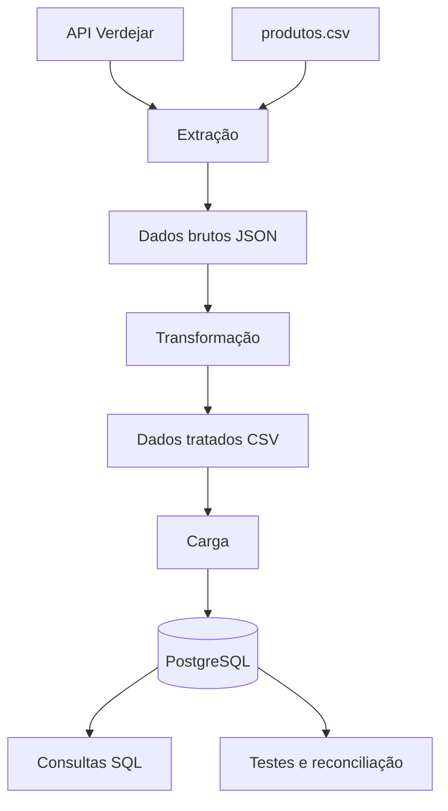
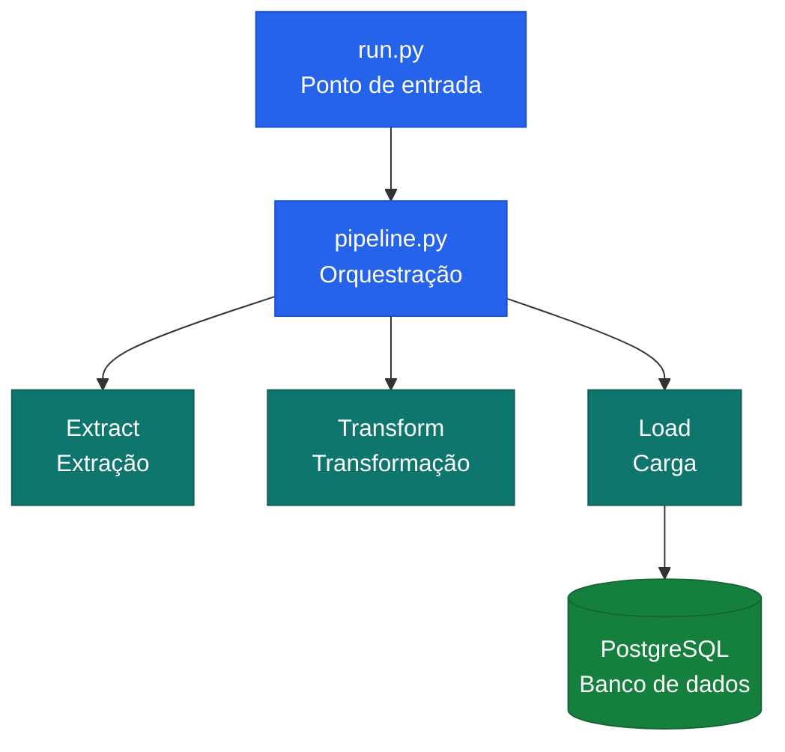

# ETL Verdejar --- AI-Driven Data Engineering

Projeto desenvolvido como Desafio Final do programa **AI/R Fellowship
--- AI-Driven Data Engineering**. O objetivo é construir um processo ETL
para integrar dados de clientes, pedidos e produtos, tratar problemas de
qualidade, carregar as informações no PostgreSQL e validar a integridade
dos dados.

## Sumário

-   [Sobre o projeto](#-sobre-o-projeto)
-   [Arquitetura](#-arquitetura)
-   [Tecnologias](#-tecnologias)
-   [Estrutura do projeto](#-estrutura-do-projeto)
-   [Extração](#-etapa-1--extração)
-   [Transformação](#-etapa-2--transformação)
-   [Contrato de dados](#-contrato-de-dados)
-   [Carga](#-etapa-3--carga-no-postgresql)
-   [Testes e reconciliação](#-etapa-4--testes-e-reconciliação)
-   [Stretch](#-stretch--orquestração-local)
-   [Configuração e execução](#-configuração-do-ambiente)
-   [Resultados](#-resultados-e-validações)
-   [Documentação complementar](#-documentação-complementar)

## Sobre o projeto

A Verdejar é uma loja virtual fictícia do segmento de hortifrúti. Os
dados de clientes e pedidos são disponibilizados por uma API REST local,
enquanto o catálogo de produtos é fornecido em CSV.

O desafio consiste em extrair, transformar e carregar esses dados em um
banco relacional, garantindo qualidade, consistência, integridade
referencial e possibilidade de reprocessamento.

## Arquitetura

O projeto segue o padrão ETL (*Extract, Transform, Load*).



**Fluxo:** extração dos dados → preservação dos arquivos brutos →
transformação e padronização → gravação dos CSVs tratados → carga no
PostgreSQL → validação.

## Tecnologias

  Tecnologia      Aplicação
  --------------- ---------------------------------------
  Python          Linguagem principal
  Pandas          Manipulação e transformação dos dados
  Requests        Requisições HTTP à API
  PostgreSQL      Banco de dados relacional
  Docker          Execução do PostgreSQL em contêiner
  SQLAlchemy      Integração com o banco
  Psycopg2        Driver PostgreSQL
  Pytest          Testes automatizados
  Python-dotenv   Variáveis de ambiente
  Git e GitHub    Versionamento

## Estrutura do projeto

``` text
desafio-fellowship/
├── dados-brutos/
├── dados-tratados/
├── etl/
│   ├── __init__.py
│   ├── extract.py
│   ├── transform.py
│   ├── load.py
│   └── pipeline.py
├── insumos/
│   ├── dados/
│   ├── api_verdejar.py
│   ├── gerar_dados.py
│   ├── schema.sql
│   └── README_insumos.md
├── tests/
│   ├── test_transformacao.py
│   └── consultas_validacao.sql
├── .env.example
├── .gitignore
├── COMO_USEI_IA.md
├── CONTRATO_DE_DADOS.md
├── requirements.txt
└── run.py
```

Os arquivos de ambiente, dados temporários e notebooks de
desenvolvimento são mantidos fora do versionamento conforme as regras do
`.gitignore`.

## Etapa 1 --- Extração

A extração consome os dados disponibilizados pela API Verdejar e obtém o
catálogo de produtos.

  Fonte             Dados
  ----------------- -----------------------------
  API `/clientes`   Cadastro de clientes
  API `/pedidos`    Pedidos e respectivos itens
  `produtos.csv`    Catálogo de produtos

A API utiliza paginação por meio dos parâmetros `page` e `page_size`. O
processo percorre as páginas disponíveis, verifica o status HTTP e trata
possíveis erros de comunicação.

Os dados extraídos são preservados em arquivos JSON na pasta
`dados-brutos/`. Essa estratégia permite reprocessar os dados sem
consultar novamente a API.

## Etapa 2 --- Transformação

A transformação é realizada em `etl/transform.py`, utilizando Pandas e
funções específicas para tratar os problemas de qualidade.


### Tratamento das armadilhas A1 a A6

| Código | Problema | Tratamento |
|:---:|---|---|
| A1 | E-mails ausentes | Preservar o cliente e manter o e-mail como nulo |
| A2 | Estados em formatos diferentes | Padronizar as siglas para maiúsculas |
| A3 | Datas em formatos diferentes | Converter para o formato de data esperado pelo banco |
| A4 | Valores com vírgula decimal | Converter para valores numéricos |
| A5 | Pedidos repetidos | Remover duplicidades pelo identificador do pedido |
| A6 | Divergência entre valor do pedido e soma dos itens | Calcular `valor_itens` e identificar pedidos divergentes |


### Normalização dos itens

Os itens dos pedidos são estruturas aninhadas nos registros da API. A
função `pandas.json_normalize()` é utilizada para organizá-los em uma
tabela independente, com pedido, produto, quantidade, preço unitário e
linha.

### Cálculo de valores e divergências

O valor dos itens é calculado pela soma de `quantidade × preco_unitario`
e comparado ao valor total informado no pedido. Quando a diferença
ultrapassa um centavo, o pedido é marcado como divergente.

Durante a transformação são contabilizados e-mails nulos, estados
padronizados, datas e valores convertidos, pedidos repetidos descartados
e pedidos divergentes.

Os dados tratados são gravados em CSV na pasta `dados-tratados/`.


O modelo relacional possui quatro tabelas:

| Tabela | Finalidade |
|---|---|
| `clientes` | Dados cadastrais dos clientes |
| `produtos` | Catálogo de produtos |
| `pedidos` | Pedidos e indicadores de divergência |
| `itens_pedido` | Produtos associados a cada pedido |

As tabelas utilizam chaves primárias e estrangeiras para garantir a integridade referencial. A tabela `itens_pedido` possui chave primária composta por `pedido_id` e `linha`.


Consulte [CONTRATO_DE_DADOS.md](CONTRATO_DE_DADOS.md) para visualizar o
dicionário completo.

## Etapa 3 --- Carga no PostgreSQL

A carga é implementada em `etl/load.py`, utilizando Pandas, SQLAlchemy e
Psycopg2. A conexão é configurada por variáveis de ambiente, evitando
credenciais diretamente no código.

### Ordem de carga

A inserção respeita as dependências das chaves estrangeiras:

1.  `produtos`
2.  `clientes`
3.  `pedidos`
4.  `itens_pedido`

### Idempotência

Foi adotada a estratégia `ON CONFLICT DO NOTHING`, utilizando o recurso
de inserção do dialeto PostgreSQL do SQLAlchemy em conjunto com
`to_sql(..., if_exists="append")` e um método personalizado.

Assim, conflitos de chaves únicas são ignorados e a execução repetida
não duplica registros já existentes.

**Limitação:** essa estratégia ignora registros em conflito, mas não
atualiza os dados existentes. Alterações em registros com o mesmo
identificador não são refletidas automaticamente no destino.

## Etapa 4 --- Testes e reconciliação

Os testes automatizados são implementados com Pytest e organizados na
pasta `tests/`. Eles verificam se as funções de transformação produzem
os resultados esperados para entradas conhecidas.

### Testes de transformação

Os casos contemplam as armadilhas, com atenção aos requisitos mínimos:

-   A3 --- Conversão de datas.
-   A4 --- Conversão de valores monetários com vírgula.
-   A5 --- Remoção de pedidos repetidos.

### Reconciliação

A reconciliação compara os dados de origem com os dados persistidos no
PostgreSQL:

-   Quantidade de pedidos únicos na origem e na tabela `pedidos`.
-   Soma dos valores dos itens na origem e no destino.
-   Diferença entre os valores, com tolerância de um centavo.

### Consultas SQL

O arquivo `tests/consultas_validacao.sql` reúne as consultas para:

1.  Total de vendas por mês.
2.  Quantidade de pedidos por estado.
3.  Relação dos pedidos divergentes.

Também é verificado se a soma dos totais mensais corresponde à soma
geral dos pedidos.

Execute os testes na raiz do projeto:

``` bash
pytest
```

**Resultado do Pytest:** atualizar com a saída real da execução final,
incluindo a quantidade de testes aprovados e eventuais falhas.

## Stretch --- Fluxo de Orquestração

Como melhoria adicional, foi desenvolvida uma estrutura de orquestração para executar o processo ETL por meio de um único
comando.
O processo é coordenado pelo `pipeline.py`, que executa sequencialmente as etapas de extração, transformação e carga.





### `run.py`

É o ponto de entrada da aplicação. Responsável por configurar o logging, iniciar o pipeline, apresentar o resumo final e tratar exceções durante a execução.

### `etl/pipeline.py`

Coordena sequencialmente as etapas de extração, transformação e carga, reunindo as métricas em um resultado consolidado.

Execute o processo completo com:

```bash
python run.py
```

### `run.py`

É o ponto de entrada da aplicação. Responsável por configurar o logging,
iniciar o pipeline, apresentar o resumo final e registrar/tratar
exceções durante a execução.
Essa implementação facilita a execução, manutenção e organização do
processo.

## Configuração do ambiente

### 1. Clonar o repositório

``` bash
git clone https://github.com/wallacee20/desafio-felloship.git
cd desafio-felloship
```

### 2. Criar e ativar o ambiente virtual

``` bash
python -m venv .venv
```

No Windows PowerShell:

``` powershell
.venv\Scripts\Activate.ps1
```

### 3. Instalar as dependências

``` bash
pip install -r requirements.txt
```

### 4. Configurar as variáveis de ambiente

Crie o arquivo `.env` na raiz, utilizando `.env.example` como
referência.

Exemplo:

``` env
DB_HOST=localhost
DB_PORT=5432
DB_NAME=verdejar
DB_USER=postgres
DB_PASSWORD=sua_senha
```

Não compartilhe o arquivo `.env` nem envie credenciais ao GitHub.

### 5. Preparar o PostgreSQL

Inicie o contêiner Docker e garanta que o banco `verdejar` esteja
disponível. Em seguida, aplique o esquema:

``` bash
docker exec -i verdejar-pg psql -U postgres -d verdejar < insumos/schema.sql
```

### 6. Iniciar a API

Inicie a API pelo script disponibilizado em `insumos/api_verdejar.py`. A
API deve estar disponível em:

``` text
http://127.0.0.1:8000
```

A rota `/saude` pode ser utilizada para verificar se o serviço está
respondendo.

## Como executar o projeto

Com o ambiente virtual ativado, a API em execução e o PostgreSQL
preparado, execute na raiz:

``` bash
python run.py
```

O comando inicia o pipeline completo:

``` text
EXTRAÇÃO → TRANSFORMAÇÃO → CARGA
```

Para executar somente os testes:

``` bash
pytest
```

## Resultados e validações

Resultados observados durante o desenvolvimento:

### Indicadores da transformação

| Indicador | Resultado observado |
|:---|---:|
| Clientes extraídos | 1.000 |
| Produtos | 12 |
| Pedidos brutos | 5.100 |
| Pedidos únicos | 5.000 |
| Pedidos repetidos descartados | 100 |
| Itens dos pedidos | 12.455 |
| E-mails nulos | 81 |
| Estados padronizados | 151 |
| Pedidos divergentes | 238 |

### Reconciliação dos valores

| Indicador | Valor |
|:---|---:|
| Soma dos itens na origem | R$ 311.228,75 |
| Soma dos itens no destino | R$ 311.228,75 |
| Diferença | R$ 0,00 |

**Resultado:** os valores da origem e do destino apresentaram diferença de R$ 0,00, atendendo à reconciliação realizada durante a transformação.

Os resultados representam números observados durante o desenvolvimento. A evidência definitiva deve ser conferida na execução final do pipeline e na reconciliação após a carga.

### Evidências complementares

- Código de extração e transformação.
- Contrato de dados.
- Testes automatizados com pytest.
- Consultas SQL de validação.
- Resultados da execução do ETL.

## Documentação complementar

  ----------------------------------------------------------------------------------------------------
  Arquivo                                                          Descrição
  ---------------------------------------------------------------- -----------------------------------
  [CONTRATO_DE_DADOS.md](CONTRATO_DE_DADOS.md)                     Dicionário de dados e regras de
                                                                   transformação

  [COMO_USEI_IA.md](COMO_USEI_IA.md)                               Sugestões aceitas, rejeitadas e
                                                                   falhas/retrabalho

  [insumos/README_insumos.md](insumos/README_insumos.md)           Orientações sobre os insumos

  [tests/consultas_validacao.sql](tests/consultas_validacao.sql)   Consultas SQL de validação
  ----------------------------------------------------------------------------------------------------

## Autor

<div align="center">

# Wallace Almeida

### Data Engineer | Cloud Engineer Jr.

Engenharia de Dados • Python • SQL • Databricks • GCP

[](https://www.linkedin.com/in/wallace-almeida-amaral/)

</div>

Estudante de Tecnologia em Internet das Coisas e profissional de Tecnologia da Informação, com foco em Engenharia de Dados e Cloud Computing.

------------------------------------------------------------------------

*Projeto desenvolvido no programa AI/R Fellowship | AI-Driven Data Engineering com foco em aprendizado prático de Engenharia de
Dados, qualidade, integridade e confiabilidade dos dados.*
